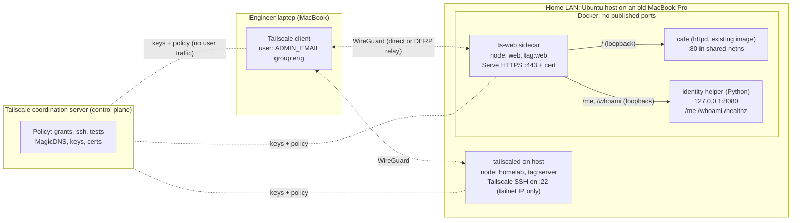

# Architecture

## Components



Two nodes on one physical machine, by design:

| Node | Identity | Purpose | Why separate |
|---|---|---|---|
| `homelab` | `tag:server` | Tailscale SSH to the host OS | Host admin access and app access have different audiences |
| `web` | `tag:web` | The cafe site (and identity helper) via Serve | The app can be moved to another host or k8s without touching policy; a compromise of the container does not get the host's tailnet identity |

## Traffic flow 1: engineer opens the web app

```mermaid
sequenceDiagram
  autonumber
  participant B as Browser on Mac
  participant D as MagicDNS 100.100.100.100
  participant TM as tailscaled (Mac)
  participant TW as ts-web sidecar (tag:web)
  participant A as cafe httpd :80 (or helper :8080 for /me)
  B->>D: resolve web.<tailnet>.ts.net
  D-->>B: 100.x.y.z (tailnet IP of web)
  B->>TM: TCP 443 to 100.x.y.z
  TM->>TW: WireGuard packet (encrypted end-to-end)
  Note over TW: Packet filter: is src in a grant to tag:web tcp:443? yes
  TW->>TW: Serve terminates TLS (Let's Encrypt cert for web.<tailnet>.ts.net)
  TW->>A: HTTP + Tailscale-User-Login: ADMIN_EMAIL
  A-->>B: cafe page (or "Hello, <name>" at /me; no app auth code)
```

## Traffic flow 2: engineer SSHes to the host

1. `ssh ravi@homelab.<tailnet>.ts.net` resolves via MagicDNS to the host's tailnet IP.
2. The packet filter on `homelab` checks for a grant `group:eng -> tag:server tcp:22`.
3. tailscaled's built-in SSH server (not OpenSSH) evaluates the `ssh` rules: `check` mode means the user must have re-authenticated with Google recently. If not, the terminal prints a URL.
4. The session runs as the Linux user named in the policy. `root` is denied by policy, and this is asserted by `sshTests`.
5. No SSH keys are created, copied, or rotated. Revoking access means removing the user from `group:eng`.

## Where enforcement happens

* **Distributed enforcement.** Every node receives only the subset of policy relevant to it and filters inbound packets itself. There is no central firewall or VPN concentrator in the data path.
* **Control plane vs data plane.** The coordination server distributes keys, policy and DNS config. User traffic never passes through it. It goes peer-to-peer, or through an encrypted DERP relay when NAT traversal fails. DERP relays cannot decrypt traffic.
* **Defense in depth on the host.** The app binds to loopback, Docker publishes no ports, and `harden-host.sh` optionally closes the LAN interface entirely.
